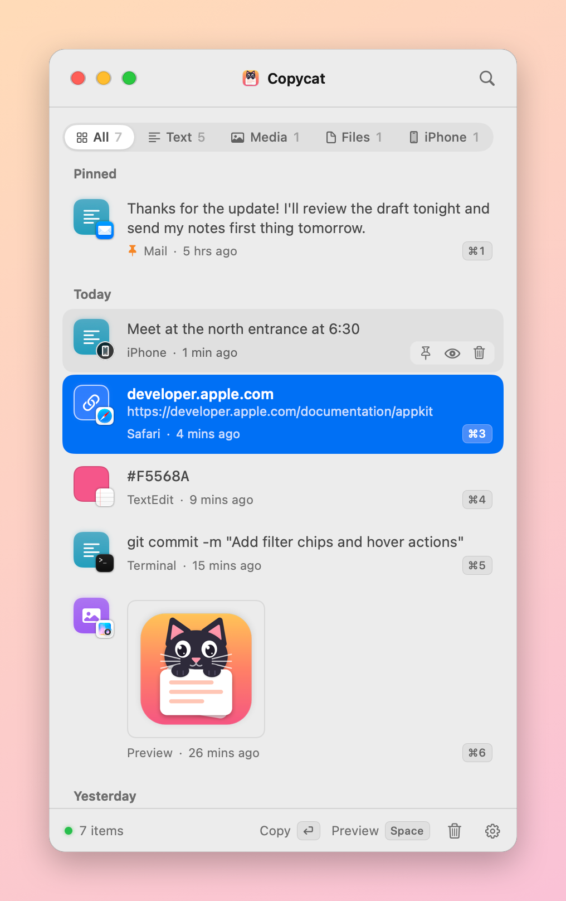
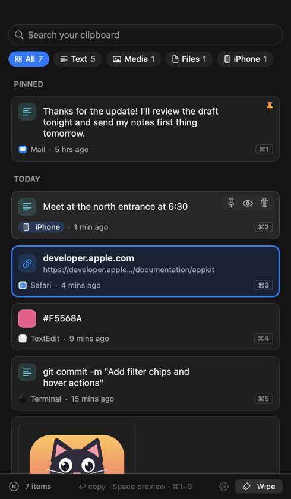

<p align="center">
  
</p>

<h1 align="center">Copycat</h1>

<p align="center">Clipboard history for your Mac, in the Dock. Free and open source.</p>

```bash
curl -fsSL https://chavdaujjval.github.io/copycat/install | bash
```

<p align="center"><sub>or <code>brew install chavdaujjval/tap/copycat</code> · macOS 14 or later</sub></p>

<p align="center">
  
  &nbsp;
  
</p>

## Features

- Press <kbd>⌃</kbd><kbd>⌘</kbd><kbd>V</kbd> anywhere to open your history. Click an item to copy it.
- Keeps iPhone copies too, including photos.
- <kbd>⌘1</kbd>–<kbd>⌘9</kbd> copies the first nine items. <kbd>Space</kbd> previews. <kbd>⌘Z</kbd> undoes a remove.
- Search, filter, pin, and drag items in or out.
- Optional: pastes for you after you pick an item.

## Privacy

- Your history stays on your Mac. Copycat never connects to the internet.
- Passwords copied from password managers are skipped.
- Items are deleted after a day unless you pin them (you can change this in Settings).

## Install

**Terminal:** run the command at the top. It downloads the latest release, checks it, and puts Copycat in Applications. It doesn't use `sudo`. [Read the script](install.sh).

**Homebrew:** `brew install chavdaujjval/tap/copycat`

**Disk image:** download [Copycat.dmg](https://github.com/ChavdaUjjval/copycat/releases/latest/download/Copycat.dmg) and drag Copycat to Applications. macOS will block it the first time, because Copycat isn't notarized by Apple. Go to **System Settings → Privacy & Security** and click **Open Anyway**.

**Uninstall:** quit Copycat and move it to the Trash. Your history is in `~/Library/Application Support/Copycat`.

## Verify a download

Each release is built by GitHub Actions from this repo:

```bash
shasum -a 256 -c Copycat.dmg.sha256
gh attestation verify Copycat.dmg -R ChavdaUjjval/copycat
```

## Build it yourself

```bash
./build.sh --install
```

See [CONTRIBUTING.md](CONTRIBUTING.md) for details.

## License

[MIT](LICENSE)
